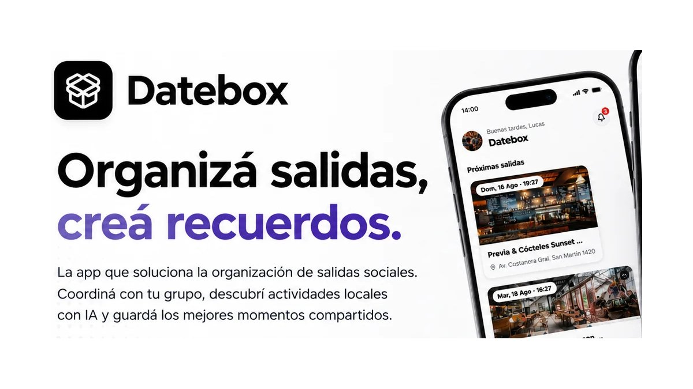
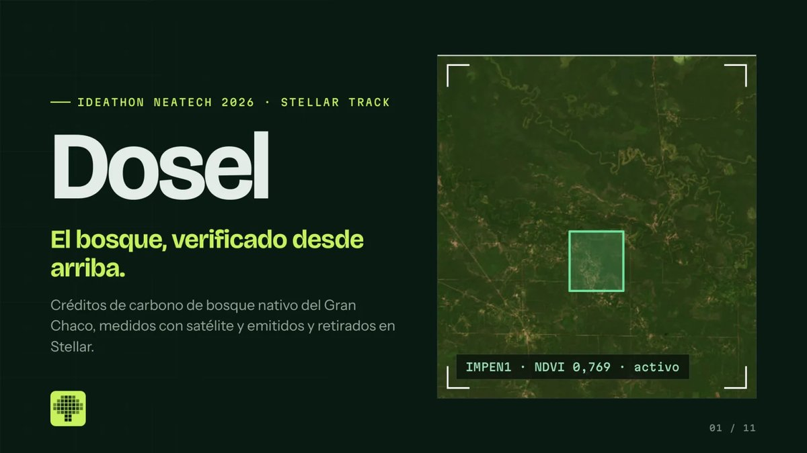
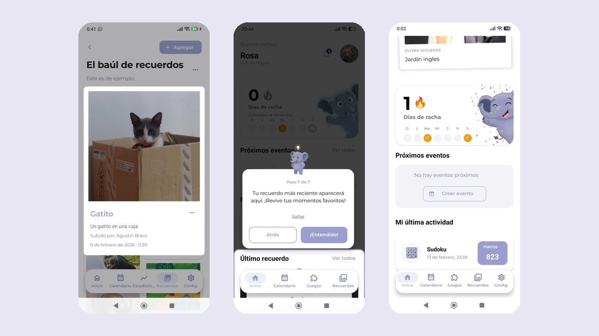
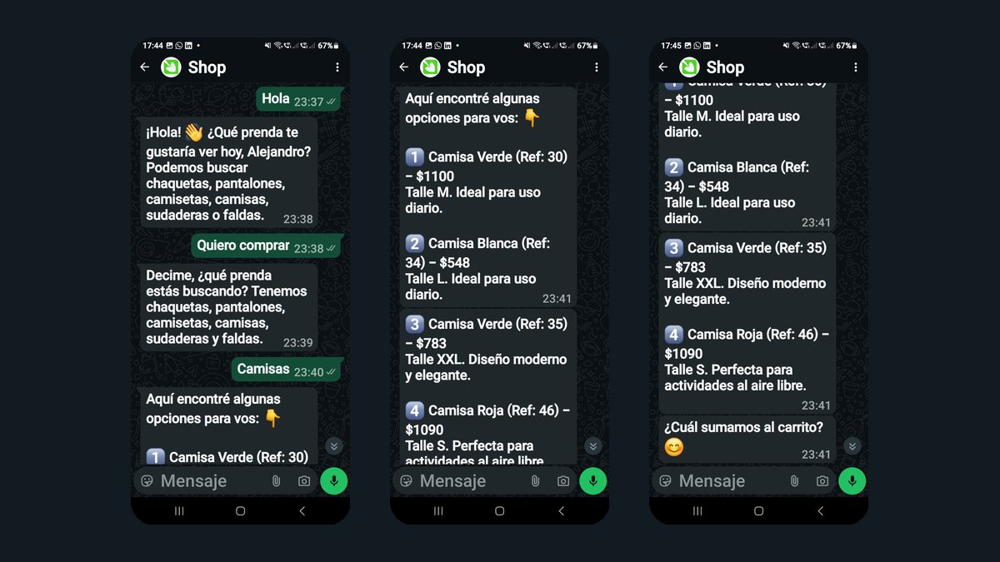
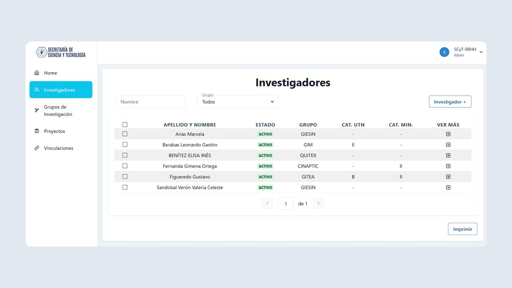
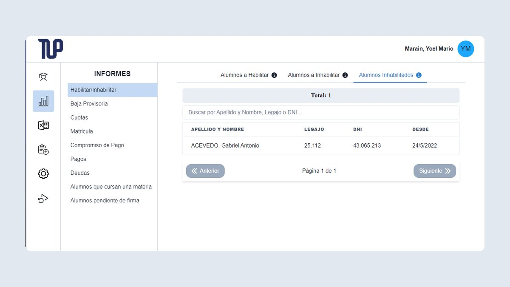

### Tobías Maciel Meister

Ingeniero en Sistemas de Información (UTN FRRe). Desarrollo productos web y móviles con inteligencia artificial, de la base de datos al despliegue.

[Portfolio](https://tobiasmaciel.github.io/Portfolio/) · [LinkedIn](https://www.linkedin.com/in/tobias-alejandro-maciel-meister-41ba39218/) · [Email](mailto:tobiasmaciel03@gmail.com)

 

**Ahora**

- **Logística Argentina** · CRM con agentes de IA, plataforma de gestión interna y DistriApp, la app de una red de más de 300 transportistas.
- **[Asymmetric](https://asymmetric.com.ar)** · Estudio de software independiente que formamos cuatro ingenieros. Desarrollamos [Datebox](https://datebox.com.ar), nuestra app en Google Play, y proyectos para clientes como [DÚO Propiedades](https://www.duopropiedades.com.ar).

 

**Proyectos**

<table>
  <tr>
    <td width="50%" valign="top">
      
       <b><a href="https://datebox.com.ar">Datebox</a></b>
       App para organizar salidas en grupo, con recomendaciones de IA.
    </td>
    <td width="50%" valign="top">
      
       <b><a href="https://github.com/SixtoArrejin/ideathon">Dosel</a></b>
       Créditos de carbono verificados por satélite, sobre Stellar.
    </td>
  </tr>
  <tr>
    <td width="50%" valign="top">
      
       <b><a href="https://github.com/elepad-org/Elepad">Elepad</a></b>
       App para adultos mayores que convierte recuerdos en álbumes narrados.
    </td>
    <td width="50%" valign="top">
      
       <b><a href="https://github.com/TobiasMaciel/laburen-challenge-aiengineer">Agente de ventas</a></b>
       Agente de IA que vende por WhatsApp, conectado a un CRM mediante MCP.
    </td>
  </tr>
  <tr>
    <td width="50%" valign="top">
      
       <b><a href="https://github.com/SixtoArrejin/frre-scyt-research-manager">SGI</a></b>
       Gestión de investigación de la UTN FRRe, en producción.
    </td>
    <td width="50%" valign="top">
      
       <b><a href="https://github.com/Seminario-Integrador-2024/GestionTUP">GestionTUP</a></b>
       Sistema de gestión académica con despliegue continuo.
    </td>
  </tr>
</table>

 

**Reconocimientos**

1.er premio Stellar, Ideathon NeaTech 2026 · 3.er puesto, Rally Latinoamericano de Innovación 2026 y 2024 · Finalistas nacionales, CubeSat 2025

 

